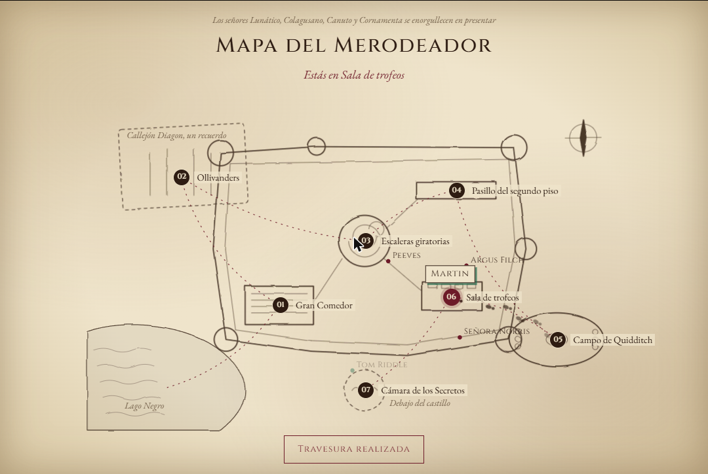
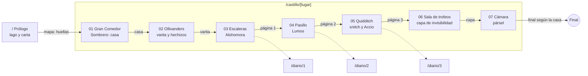

# Mapa de navegación

Entregable "Mapa del recorrido o diagrama de navegación" de la consigna. Abajo está el diagrama de rutas; la captura es el Mapa del Merodeador del sitio con el recorrido completo.

## Rutas

| Ruta | Tipo | Qué muestra |
| --- | --- | --- |
| `/` | Estática | Prólogo: llegada en bote con scroll. "Abrir el diario" (o "Seguir en…" si ya habías entrado) |
| `/castillo/[lugar]` | Dinámica, 7 páginas generadas con `generateStaticParams` | Cada lugar del recorrido con su escena 3D |
| `/diario/[pagina]` | Dinámica, 3 páginas generadas con `generateStaticParams` | Las páginas arrancadas del diario, legibles cuando ya las conseguiste |
| Cualquier otra | `not-found.js` | "Este pasillo no figura en ningún mapa" |

## Recorrido

- **Desbloqueo:** cada lugar se abre cuando conseguiste el ítem del anterior. Si entrás por la URL a uno bloqueado, se ve "Este lugar todavía no aparece en tu mapa" con el camino de vuelta.
- **Transiciones:** al pasar al siguiente lugar se abre el Mapa del Merodeador y tus huellas caminan hasta el destino. Después, un velo de tinta tapa la pantalla con el nombre del lugar y se retira recién cuando la escena nueva dibujó su primer cuadro (`lib/transition.js`, `components/PlaceVeil.js`).
- **Navegación libre:** la barra de lugares y el mapa (botón "Mapa" o tecla M) llevan a cualquier lugar ya revelado.
